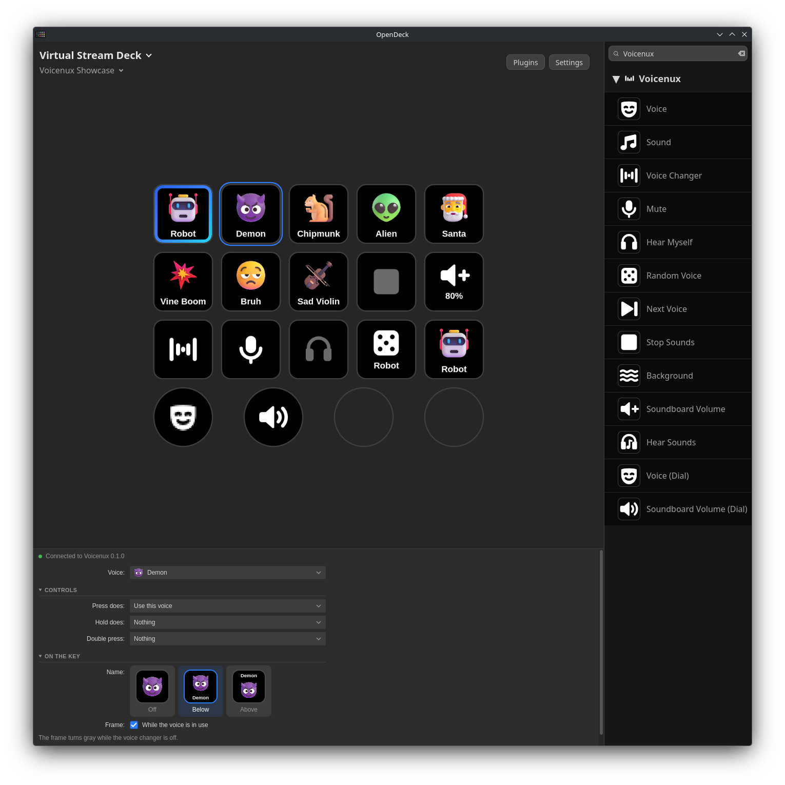

<p align="center">
  
</p>

<h1 align="center">Voicenux for OpenDeck</h1>

<h3 align="center">Control your voice changer from your Stream Deck. Made for Linux.</h3>

<p align="center">
  Voices with their pictures, the soundboard, mute, push to talk and push to change your voice for <a href="https://github.com/voicenux/voicenux">Voicenux</a>, on <a href="https://github.com/nekename/OpenDeck">OpenDeck</a>.
</p>

<h5 align="center">
  <a href="#install">Install</a> |
  <a href="#how-to-use">How to use</a> |
  <a href="#actions">Actions</a> |
  <a href="https://github.com/FeloDeck/voicenux-plugin/issues">Report a bug</a>
</h5>

<p align="center">
  <a href="https://ko-fi.com/felitendo"></a>
</p>

<p align="center">
  
</p>

## Install

You need OpenDeck 2, Node.js 22 or newer and Voicenux 0.1.0 or newer.

Download `de.felitendo.voicenux.streamDeckPlugin` from the [latest release](https://github.com/FeloDeck/voicenux-plugin/releases/latest) and install it on the **Plugins** page of OpenDeck.

<details>
<summary>From source</summary>

```bash
git clone https://github.com/FeloDeck/voicenux-plugin.git
cd voicenux-plugin
make install
```

Then restart OpenDeck. With the OpenDeck Flatpak, install into its folder:

```bash
make install PLUGINS=~/.var/app/me.amankhanna.opendeck/config/opendeck/plugins
```

`make package` builds `dist/de.felitendo.voicenux.streamDeckPlugin`.

</details>

## How to use

1. In Voicenux, open **Settings → Other apps** and turn on **Let other apps control Voicenux**.
2. In OpenDeck, drag an action from **Voicenux** onto a key.
3. In the settings of the key, pick a voice or a sound.

Voice keys show the picture of their voice, with a blue frame while it is in use. The frame turns gray while the voice changer is off. Sound keys get the frame while they play.

If Voicenux is not running, the keys show **Voicenux off**. If it does not let other apps in, they show **API off**, and the settings of any key have a button that opens the settings of Voicenux. A key with a yellow dot still needs its settings.

## Actions

<details>
<summary>All 14 actions</summary>

| Action | What it does |
|---|---|
| Voice | Turn a voice on or off (off is your own voice), use it only while you hold the key, or star it. |
| Sound | Play a sound from the start, on top, or play and stop it. |
| Voice Changer | Turn the voice changer on or off, or push to change your voice. |
| Own Voice | Back to your own voice, whatever voice is on. White while a voice is on. |
| Mute | Mute or unmute your microphone, push to talk or push to mute. |
| Hear Myself | Hear your changed voice in your headphones. |
| Random Voice | A random voice, out of your favorites when you have two or more. |
| Next Voice | The next or previous voice, out of your favorites when you have some. Can show the voice in use. |
| Stop Sounds | Stop all sounds that play. White while one plays. |
| Background | Background sounds of the voice on or off. |
| Soundboard Volume | Make the sounds louder, quieter or set their volume. Hold to keep going. |
| Hear Sounds | Hear the sounds yourself too. |
| Voice (Dial) | Turn to pick a voice (with its picture), press to use it. Only favorites if you like. |
| Soundboard Volume (Dial) | Turn for the soundboard volume, press to stop all sounds. |

Most keys can do one thing on press, another on hold and another on double press. Keys that turn something on or off can also only turn it on, or only off (that helps in multi actions), or keep it on only while you hold the key.

</details>

## Credits

The pictures of voices and sounds come from Voicenux: [Fluent Emoji](https://github.com/microsoft/fluentui-emoji) by Microsoft (MIT). Thanks to the OpenDeck developers.

BSD-3-Clause.
